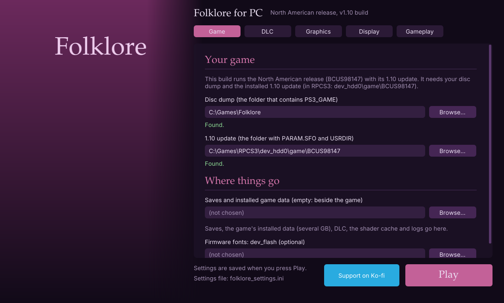
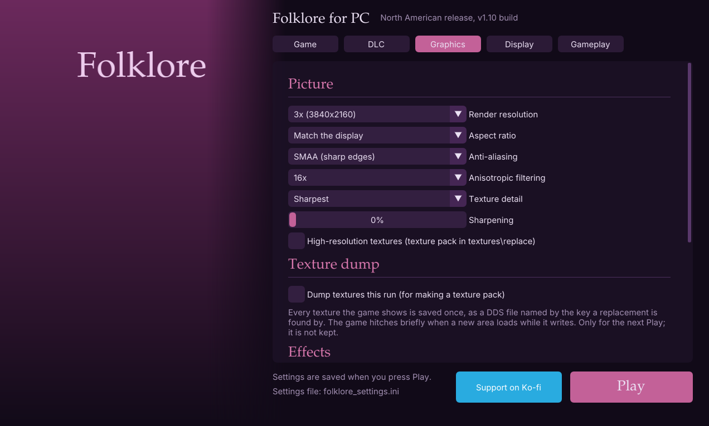

# Folklore (PS3) — native PC recompilation

If you like this feel free to buy me a coffee :) https://ko-fi.com/mavab

Folklore (Game Republic / SCE, 2007) statically recompiled from its PS3
executable to native x86-64 Windows code with
[ps3recomp](https://github.com/sp00nznet/ps3recomp). There is no emulator: the
game's PowerPC and SPU code is translated to C++ and runs on a runtime that
stands in for the PS3's OS, with Direct3D 12 for graphics.

**This repository contains no game code and no Sony code.** You build the game
yourself from **your own disc**; setup does the translation on your PC. No PS3
firmware is needed: the SPU job system the game runs on (SPURS) is
reimplemented here ([`folklore/docs/SPURS.md`](folklore/docs/SPURS.md)).

**Status:** playable on the author's PC (Windows 11, Ryzen 7 7800X3D): it boots,
does the first-boot install, and plays, including capturing Folks with
the original motion controls. Expect rough edges.
[`folklore/docs/STATUS.md`](folklore/docs/STATUS.md) is the full engineering
log.

### New in v0.5: the launcher



**FolkloreLauncher.exe** (double-click **run_launcher.bat**) sets the game
up in one window: your disc dump, the 1.10 update and your DLC, each checked
as you choose it, and every graphics, display and gameplay setting. Then
press **Play**. No scripts or settings files to edit; the in-game engine
menu is still there too. See [*The launcher*](#the-launcher).

Also in v0.5: licences (.rap) added from a button, the title bar showing the
real render size, and a fix for the logo movie looping over a blue screen
when the game was started outside run.ps1 in a project folder.

### What's better than on the PS3

All of these are in the in-game engine menu (**L3 + R3** or **F1**); each can
be turned back to the original.

- **Frame rate**: 60 fps or unlimited (up to your display's refresh rate),
  with physics stepped to match so cloth and hair stay stable.
- **Resolution**: up to 3x the PS3's 1280×720, borderless fullscreen.
- **Ultrawide**: 21:9, 32:9 or your display's shape, with a wider field of
  view rather than a stretched picture; the map and gauges move out to the
  screen's edges (with a *How far out* slider), and menus, speech bubbles
  and fades stay where they belong.
- **Anti-aliasing**: SMAA (sharp, clean edges) or FXAA.
- **Sharper textures**: finer texture levels in the distance, plus up to 16x
  anisotropic filtering and optional sharpening.
- **Ambient occlusion**: soft shading where surfaces meet — corners, under
  ledges, around characters' feet.
- **Soft shadows**: the characters' shadows with soft edges instead of hard,
  stair-stepped ones.
- **Smooth depth of field**: a soft, round blur using the game's own focus,
  without the original's doubled image.
- **Smooth bloom**: a steady glow, without the original's flicker.
- **Cleaner Id souls**: the enemies' souls as a soft shimmer (or a clear
  translucent shape) instead of pixel static.
- **Faster busy scenes**: objects drawn again and again (Doolin's streets)
  reuse work instead of being redrawn from scratch, unchanged models stay on
  the graphics card instead of being copied every frame, and large textures
  are no longer re-read every frame — boss fights hold 60 fps.
- **A launcher**: set the game's folders, DLC and every setting in one
  window, then Play.
- **Quality of life**: skip the opening logos with Start, save backups and
  restores, no RPCS3 needed to decrypt the game, downloadable content added
  from the menu, motion controls on any controller with motion sensors.

Builds can be made from the v1.00 disc or from the game's **1.10 update**
(rumble, and the newer Folk data), and the **downloadable content** you bought
can be added from the in-game menu — see
[*1.10 with the DLC, step by step*](#110-with-the-dlc-step-by-step).

---

## Requirements — read this first

You need **both** of these. Neither is in this repository and neither can be
downloaded from it.

### 1. Your own Folklore disc: North American or European release

- **Title ID BCUS98147 (North America) or BCES00050 (Europe), disc version
  1.00.** The code is translated from those exact executables; the Japanese
  release will not work. A build is made from one of them and runs that one
  ([`folklore/docs/REGIONS.md`](folklore/docs/REGIONS.md)).
- **Optionally, the 1.10 update** for your release. A build can be made from
  the update's executable instead (it adds rumble, the game's own Vibration
  option, and the newer table of Folks that later downloadable content uses);
  it still reads everything else from your disc dump. See *The 1.10 update*
  below.
- Dumped from your disc to a **folder** (the "JB folder" format RPCS3 uses): a
  folder that contains `PS3_GAME\`, with `PS3_GAME\PARAM.SFO` and
  `PS3_GAME\USRDIR\EBOOT.BIN` in it. Your dump is only ever read, never
  written to.

### 2. The game's EBOOT: nothing to do

The dumped `PS3_GAME\USRDIR\EBOOT.BIN` is encrypted; setup and the game
decrypt it themselves (no RPCS3 needed) into a `decrypted\` folder here —
nothing is written to your dump. An `EBOOT.elf` RPCS3 already wrote beside it
(*Utilities → Decrypt PS3 Binaries*) is used as it is. The decrypted file is
**6,518,936 bytes** (BCUS98147) or **6,518,912 bytes** (BCES00050); setup
checks this. ([`folklore/docs/SELF.md`](folklore/docs/SELF.md) has how.)

`decrypted\` holds the game's own code: like `folklore.exe`, don't share it.

### The 1.10 update (optional)

Install the update in RPCS3 (**File → Install Packages/Raps/Edats**, choose
the update's `.pkg`). RPCS3 puts it in `dev_hdd0\game\BCUS98147` (or
`BCES00050`) inside its own folder — not in your disc dump, even though
RPCS3's game list shows the game as 1.10 and *Open game folder* opens the
dump. Its `USRDIR\EBOOT.BIN` is decrypted here too: the European one needs
nothing, the North American one its licence (`UP9000-BCUS98147_00-FOLKLORE20000003.rap`),
which RPCS3 installs with the update into `dev_hdd0\home\<user>\exdata` —
setup finds it there. Give setup both folders:

```powershell
.\setup.ps1 -GameDir D:\Games\BCUS98147 -UpdateDir D:\RPCS3\dev_hdd0\game\BCUS98147
```

setup lifts the update's executable instead of the disc's and saves both
folders; `build.ps1` and `run.ps1` work as before. On each start the game
copies the update's three data files (`LMonS2.bi5_`, a corrected Spanish
text file, and their list) from the update folder into `hdd0\` here and
records them as installed, as the game itself would; neither folder is
written to. `.\setup.ps1 -GameDir <dump>` without `-UpdateDir` goes back to
the disc version. Saves are the same files in both versions.

### Also needed

- **Windows 10 or 11, 64-bit**, a Direct3D 12 graphics card, and a CPU with
  AVX2 (x86-64-v3: Intel Haswell / AMD Zen or newer).
- About **30 GB** free on the drive you clone to (tools, build files, and the
  game's own first-boot install of several GB).
- An internet connection for setup (it downloads its tools).
- A controller: any XInput pad, or for motion controls a **DualShock 4**,
  **DualSense** (or Edge), **Switch Pro Controller** (USB or Bluetooth, no
  extra software), or a **DualShock 3** with
  [DsHidMini](https://github.com/nefarius/DsHidMini) in **SXS** mode.

---

## Building

Clone this repository (or download it as a ZIP and unzip it) somewhere with
the space free — a short path such as `D:\Folklore` is best. Open
**PowerShell** in that folder and run these one at a time:

```powershell
powershell -ExecutionPolicy Bypass -File .\setup.ps1
powershell -ExecutionPolicy Bypass -File .\build.ps1
powershell -ExecutionPolicy Bypass -File .\run.ps1
```

1. **setup.ps1** (15–30 minutes, once)
   - **First it asks for your dump**: a folder picker (choose the folder that
     contains `PS3_GAME`). It is checked; if something is wrong (still
     encrypted, wrong version) it says what and asks again. You can also pass
     it: `.\setup.ps1 -GameDir D:\Games\BCUS98147`
   - Then it runs on its own: downloads Git, CMake, Ninja, Python and FFmpeg
     into `tools\`, and — only if you have no Visual Studio with clang-cl —
     Visual Studio 2022 Build Tools (about 6 GB, one UAC prompt; the Visual
     Studio Installer always goes on C:).
   - Translates the game's code from your `EBOOT.elf` into
     `folklore\src\recomp\` (about a minute). It stays on your PC.
   - Builds the ps3recomp runtime library.
2. **build.ps1** compiles about 1.5 million lines of translated C++: roughly
   10–30 minutes the first time on a modern 8-core CPU, incremental after
   that. Result: `folklore\build\folklore.exe`.
3. **run.ps1** starts the game and writes `logs\run-<date-time>.log`. It
   uses the game folder you gave setup (saved in `folklore_settings.ini`), and
   the game's first boot copies several GB of data into `hdd1\`.
   **run.bat** does the same with a double-click (any run.ps1 options can
   follow it, e.g. `run.bat -ResetInstall`).

Or, after build.ps1, double-click **run_launcher.bat** instead of run.ps1:
[the launcher](#the-launcher) asks for the same folders in its own window and
starts the game with Play.

With both releases (an EU copy of this folder beside it, see *Sharing what
you built*), `.\build_all.ps1` builds this folder, brings the EU copy up to
date and builds that too; then `run.bat` in either folder runs its build.
Once the 1.10 copies exist (`package_all.ps1 -UsUpdateDir/-EuUpdateDir`, see
*Sharing what you built*) it builds those as well.

### If something fails

- Every step writes a log in `logs\` (`setup-*.log`, `build.log`,
  `run-*.log`); the error message names the one to look at.
- **setup can't find clang-cl after installing Build Tools**: open *Visual
  Studio Installer* → Modify → Individual components → tick *C++ Clang Compiler
  for Windows* and *MSBuild support for LLVM (clang-cl)*, then run setup.ps1
  again.
- **"Could not decrypt ... needs its licence"** (North American 1.10 update):
  install the update's `.rap` in RPCS3 (*File → Install Packages/Raps/Edats*),
  or put it in a `licences` folder here.
- **"not a v1.00 EBOOT of a supported release"**: your disc is the Japanese
  release, or you gave `-GameDir` the 1.10 update's EBOOT (give the update
  folder as `-UpdateDir`, with `-GameDir` your disc dump). Only BCUS98147 and
  BCES00050 work.
- **"not the 1.10 update of a supported release"**: the `-UpdateDir` folder
  is not the 1.10 update — most often the disc dump was given instead of
  RPCS3's `dev_hdd0\game\<title id>` (see *The 1.10 update*). An old
  `USRDIR\EBOOT.elf` there made from the wrong EBOOT also causes it: delete it.
- **Both releases:** a build follows the dump setup lifted. `.\setup.ps1
  -GameDir <dump of the other release>` switches it (setup lifts the game code
  again, then `build.ps1` rebuilds everything). To keep one of each, use two
  copies of this folder.
- setup and build are safe to re-run; each step skips what is already done.

---

## Playing

### The launcher



**FolkloreLauncher.exe** (built beside folklore.exe, and in every package)
sets everything up in one window before the game starts. Double-click
**run_launcher.bat** to open it: in the project folder it opens the one in
`folklore\build` with this folder's settings, `hdd0`, saves and logs (the
ones `run.ps1` uses).


- **Game**: your disc dump and, for a 1.10 build, the installed 1.10 update,
  each checked the way the game checks them; where saves and installed data
  go; optional firmware fonts.
- **DLC**: the packs installed, **Add DLC from RPCS3...** and **Add licences
  (.rap)...**, and any pack still missing its licence.
- **Graphics**, **Display**, **Gameplay**: every setting of the in-game
  engine menu, including the ones that only apply when the game starts.
- **Dump textures this run** (Graphics page): the next Play starts the game
  with the texture dump on, into `textures\dump` (as `run.ps1
  -DumpTextures`); not kept between runs.
- **Play** saves `folklore_settings.ini` and starts folklore.exe;
  **Support on Ko-fi** beside it opens the project's
  [Ko-fi page](https://ko-fi.com/mavab).

Its picture is `launcher_art.jpg` (or `.png`) in the project folder (or
beside the launcher): put your own copy of the cover art there and it fills
the left-hand panel. It is not in the repository; without it the launcher
shows the plain panel in the screenshots above.

**From a package**: unzip, double-click `run_launcher.bat`, choose your disc
dump (and the 1.10 update for a 1.10 build) on the Game page, press Play.

### Engine menu

Press **L3 + R3 together** (or **F1**) in game. D-pad / left stick or the arrow
keys move, Cross / A or Enter changes a setting, Circle / B, Start or Esc
closes. The game ignores the controller while the menu is open. Settings are
saved to `folklore_settings.ini`.

- **Frame rate**: 30 fps (the game's own limiter), 60 fps or unlimited.
  Unlimited runs as fast as your display refreshes (120 or 144 fps on a
  high-refresh monitor, if your PC keeps up); movies still play at their own
  speed. Above 30 is experimental — the game was built for 30.
- **Precise frame limiter**: wakes every 1 ms instead of every 10 ms, so
  frames end on time (on by default).
- **Motion controls** (on by default): capture Folks by moving the controller,
  as on the PS3. Works with any controller that has motion sensors (below); a
  controller without them still captures by itself. Turn it off and every
  capture completes by itself, whatever the controller -- boss captures too
  (Time, Beat, Balance, Stop & Go: the capture bar fills over a few seconds
  and the game finishes the capture as if you had). The menu shows which
  controller is connected and whether its sensors are live.
- **Opening logos**: *Play them* (as on the PS3), *Start skips them*
  (the default: press **Start**, or Enter, once the logos have been on for a
  moment, and the logo movie and the still logos after it are all skipped,
  straight to the title screen), or *Never show them* (the game starts at the
  title screen after a blank second). The game's own legal notice before the
  title screen still shows.
- **Physics**: step physics by the frame time, which keeps cloth and hair
  stable above 30 fps (on by default).
- **Language** (European build only): English, French, Spanish, German or
  Italian, for the menus, text, subtitles and cutscene sound. The game picks
  its language as it starts, so a change applies on the next start. The North
  American disc only has English.
- **Graphics**
  - *Fullscreen* (borderless; **Alt+Enter** toggles it any time).
  - *Render resolution*: 1x (1280×720, the PS3's), 2x or 3x. Applies on the
    next start.
  - *Aspect ratio*: 16:9, match display, 21:9 or 32:9 — a wider field of view,
    not a stretched picture. Next start.
  - *Menus and HUD* (when wider than 16:9): *Map and gauges at the edges*
    (the default: everything at its own shape, the map pushed out to the
    left and the health gauges, folk and button hints to the right, with a
    *How far out* slider), *Centred* (all of it in the middle 16:9) or
    *Stretched to fit* (as before). Full-screen fades and backdrops always
    cover the whole screen. Applies at once.
  - *Anti-aliasing*: *SMAA* (the default for new settings: smooth edges
    that stay sharp, text and texture detail kept), *FXAA* (softer) or
    *Off*. Applies at once. *Anisotropic filtering* (up to 16x),
    *Sharpening*.
  - *Texture detail*: *Sharper* (the default), *Sharpest* or *Original* —
    finer texture levels, so walls, ground and clothing keep their detail
    further away. Applies at once.
  - *Depth of field*: *Smooth* (the default: a soft blur using the game's own
    focus, without the doubled edges) or *Original* (the PS3's). Next start.
  - *Bloom*: *Smooth* (the default: steady glow, without the flicker and
    shimmer of the original's low-resolution sampling) or *Original*. Next
    start.
  - *Shadows*: *Soft* (the default), *Softer* or *Original* — the
    characters' shadows with soft edges instead of hard, stair-stepped
    ones. Applies at once.
  - *Ambient occlusion*: *Subtle* (the default), *Strong* or *Off* — soft
    shading where surfaces meet (corners, under ledges, where characters
    stand), worked out from the depth buffer. Next start.
  - *Build new shaders in the background* (no hitch when an effect first
    appears).
  - *Fast repeated objects* (on by default): objects the game draws again
    and again with only their position changed reuse the previous draw's
    work — faster in busy towns like Doolin.
- **Game files**: the game folder in use (change it here; it applies on the
  next start) and where the installed data and saves are.
- **Downloadable content**: the add-on packs installed, **Add DLC from
  RPCS3...** to bring in your own, and **Remove** per pack (below).
- **Performance overlay**: fps, frame time and where the time goes.
- **Save data snapshots**: copy the game's saves to `save_snapshots\` and put
  any snapshot back later, then load it from the game's own Load menu.

Escape closes the menu; it does not quit the game (use the window's close
button or Alt+F4).

### 1.10 with the DLC, step by step

What you need, all your own: the Folklore disc dump (as above), the 1.10
update `.pkg` for your release, and each add-on pack's `.pkg` with its `.rap`
licence. RPCS3 is used only to install them.

1. **Install the update and the packs in RPCS3.** **File → Install
   Packages/Raps/Edats**, then select the update's `.pkg`, every pack's `.pkg`
   and every `.rap` (several at once is fine). They go into RPCS3's own
   `dev_hdd0`: the update and packs into `dev_hdd0\game\BCUS98147` (or
   `BCES00050`), the licences into `dev_hdd0\home\00000001\exdata`. You do
   not need to start the game in RPCS3.
2. **Build the 1.10 version** (the update's EBOOT is decrypted for you). In
   this folder:

   ```powershell
   .\setup.ps1 -GameDir D:\Games\BCUS98147 -UpdateDir D:\RPCS3\dev_hdd0\game\BCUS98147
   .\build.ps1
   ```

   `-GameDir` is your disc dump, `-UpdateDir` the update folder from step 1.
   To keep the disc version too, leave this folder as it is and use
   `.\build_all.ps1 -UsUpdateDir <RPCS3>\dev_hdd0\game\BCUS98147` (and/or
   `-EuUpdateDir ...\BCES00050`): it builds the 1.10 versions in copies
   beside this folder (`Folklore-1.10`, `Folklore-EU-1.10`).

   With a ready-made **1.10 package** instead (`Folklore-<date>_1.10.zip`):
   skip this step; the first time you start it, it asks for the disc dump
   and then for the update folder.
3. **Start the game** with `run.bat` (in the 1.10 copy, if you used
   `build_all.ps1`). The game's options now have a *Vibration* setting.
4. **Add the DLC.** Press **F1** (or L3+R3), go to **Downloadable content**
   and press **Add DLC from RPCS3...**. Choose RPCS3's folder — the one with
   `dev_hdd0` in it. A progress bar runs for about half a minute, then the
   menu lists the packs it installed (and any it could not, with the reason:
   usually a missing `.rap`).
5. **Restart the game.** F1 now shows *Installed: Add-on pack 1, ...*, and the
   new quests and Folks are in the game as they were on a PS3.

Good to know:

- Copied RPCS3's game folder into `hdd0\game` by hand instead? RPCS3 keeps
  the paid packs encrypted with your licences, so the port decrypts them at
  start when it finds the `.rap` files — copy RPCS3's
  `dev_hdd0\home\00000001\exdata` to `hdd0\home\00000001\exdata` too, press
  *Add licences (.rap)...* and pick the `.rap` files, or just press *Add DLC
  from RPCS3...*. F1 lists, in red, any pack still
  missing its licence (without it, its costumes and Folks are broken and the
  game can crash).
- Each project copy (and each package folder) has its own `hdd0\`, so add the
  DLC once in each one you play. `run.bat -ResetInstall` empties `hdd0\`, DLC
  included; press *Add DLC* again afterwards.
- The packs of either release work in either build: North American packs
  (with their North American licences) in a European build, and the other
  way round. The importer takes this build's own release's packs when RPCS3
  has them, and otherwise the other release's, installing their English text
  under both releases' names (`_en` / `_uk`). The other four languages are in
  both releases' packs already.
- Saves work in both versions; copy them across with the menu's save
  snapshots, or `gamedata\` between folders.
- Nothing in your disc dump or in RPCS3's folder is ever changed.

### Downloadable content

Folklore's add-on packs from your own purchase: install each pack's `.pkg`
and its `.rap` licence in RPCS3 (**File → Install Packages/Raps/Edats**), then
in the engine menu press **Add DLC from RPCS3...** and choose RPCS3's folder
(the one with `dev_hdd0` in it). The packs are decrypted with your licences
and installed into `hdd0\` here — about half a minute for all six, with a
progress bar — and the game has them from its next start. A pack without its
licence is left out and the menu says which. North American packs work in the
European build too (and the other way round). Nothing in RPCS3's folder is
changed.

To take a pack out again, press its **Remove** button (twice, to confirm) or
**Remove all DLC**. Your saves are copied to a snapshot first (a save that
uses that pack's Folks or items may not load without it), and the pack is
removed the next time you start the game; **Keep** cancels it before then.
Details: [`folklore/docs/DLC.md`](folklore/docs/DLC.md).

### Motion controllers

Folklore captures Folks with motion gestures. These controllers are read
directly — buttons, sticks and the motion sensors — and take controller port
0 (an XInput pad takes the next port):

| Controller | Connection | Notes |
|---|---|---|
| DualShock 4 (and Sony's wireless adapter) | USB or Bluetooth | no extra software |
| DualSense, DualSense Edge | USB or Bluetooth | no extra software |
| PS4/PS5-style pads from Hori, Nacon, Razer, PowerA, Mad Catz, Qanba, Victrix and others | USB or Bluetooth | no extra software; some have no motion sensors or rumble |
| Switch Pro Controller | USB or Bluetooth | buttons by position: B = Cross, A = Circle, Y = Square, X = Triangle |
| DualShock 3 | USB or Bluetooth | needs [DsHidMini](https://github.com/nefarius/DsHidMini) in **SXS** mode (set in DSHMC); also gives pressure-sensitive buttons |

Rumble (1.10 builds, the game's Vibration option) goes to an XInput pad, a
DualShock 4 or a DualSense. The Switch Pro Controller and a DualShock 3 read
through DsHidMini do not rumble yet.

A controller presented as an XInput pad by another program (DS4Windows,
Steam Input, DsHidMini in XInput mode) has no motion data. If DS4Windows hides
the real controller (HidHide), the game cannot see it either; close it or let
the game through. If two of these controllers are connected, the DualShock 3
is used, otherwise the first one found.

The log says `[cellPad] DualShock 4 connected over USB` (or Bluetooth) when
the pad is found. `found but could not be opened` means another program has
it; `HID game controller VVVV:PPPP is not one the game reads directly` means
the pad is not in the list yet: please report that VVVV:PPPP.

### run.ps1 options

```powershell
.\run.ps1 -GameDir D:\other\BCUS98147     # a different dump (otherwise the saved one)
.\run.ps1 -UpdateDir D:\RPCS3\dev_hdd0\game\BCUS98147   # 1.10 builds: a different update folder
.\run.ps1 -DevFlash D:\RPCS3\dev_flash    # firmware fonts (optional; or dev_flash= in the ini)
.\run.ps1 -ResetInstall                   # wipe hdd0/hdd1 and redo the first-boot install
.\run.ps1 -Verbose                        # very detailed logging (slow)
.\run.ps1 -Profile                        # report where the CPU time goes (every 10 s)
.\run.ps1 -Libsre                         # Sony's libsre instead of the port's SPURS, to compare (see below)
.\run.ps1 -InterpJobs                     # SPU jobs in the interpreter (A/B, slower)
.\run.ps1 -TraceSpurs                     # record what SPURS does (logs\spurs-*.trace; folklore/docs/SPURS.md)
.\run.ps1 -DumpTextures                   # write the game's textures to textures\dump (see below)
.\build.ps1 -Clean                        # full rebuild
$env:AUDIO_LATENCY_MS = '48'; .\run.ps1   # more audio buffering if sound breaks up (default 32)
```

### Running folklore.exe on its own

Start the game with run.bat / run.ps1: that is the tested way. A binaries
package (`package.ps1`) includes them, with run.ps1 finding `folklore.exe`
beside itself.

`folklore.exe` can also start without them (double-click it or a shortcut).
It asks once for the game folder (a 1.10 build also for the update folder)
and remembers it, then does what run.ps1
does: it sets the same environment and starts the game as a second
`folklore.exe` process, with its output going to `logs\run-<date-time>.log`.
`hdd0\`, `hdd1\`, `gamedata\` (saves), the shader cache and `logs\` go beside
the exe (or in `data_dir` from `folklore_settings.ini`). (Running the game in
the first process instead, as earlier builds did, drew the title screen
wrongly and stopped at a black screen.) In a project folder it finds FFmpeg
(for the movies) in `tools\ffmpeg\bin` itself, as run.ps1 does; a package
has it beside the exe.

### Dumping textures

The first step towards higher-resolution textures: `.\run.ps1 -DumpTextures`
writes every texture the game shows to `textures\dump`, once each, as you
play (`-DumpDir D:\somewhere` for another folder). Play through the areas
you want; later runs add only what is new.

- Files are DDS: `<key>_<width>x<height>_<format>.dds`. DXT textures are
  written as they are on the disc (BC1/BC2/BC3, with their mipmaps); other
  formats as plain RGBA8. Cube maps end in `_cube`.
- The 16-digit key at the start of the name is what a replacement will be
  found by, so keep it when you save an upscaled copy.
- `index.csv` in the folder lists every texture written: key, size, format,
  mip count and the frame it first appeared.
- Textures the game keeps rewriting (movie frames and the like) and render
  targets are not dumped.
- Writing a new texture takes a moment, so expect small hitches the first
  time a new area loads while dumping.

The dumped textures are the game's own art: do not share them or commit
them (`textures/` is in `.gitignore`).

### Higher-resolution textures (texture packs)

Engine menu → Graphics → **High-resolution textures (texture pack)**, then
restart the game. Replacement textures are read from `textures\replace`
(next to `folklore_settings.ini`; `texture_pack_dir =` in the ini for
another folder), including any folders inside it, so packs can be kept in
their own subfolders.

- A replacement is a `.dds` file whose name starts with the 16-digit key of
  the texture it replaces, as the dump names it: copy a file from
  `textures\dump`, upscale or repaint it, and save it under
  `textures\replace` with the key still at the front. Any size works.
- Formats: BC1-BC7 (BC7 is the best quality for its size), RGBA8 or BGRA8.
  Compressed textures need sides that are multiples of 4.
- Save with mipmaps (for example `texconv -m 0 -f BC7_UNORM file.dds`), or
  distant surfaces shimmer. Uncompressed files without them get them made
  as they load.
- A cube map can only replace a cube map.
- The menu shows how many replacements were found and how many are in use.
  A file that cannot be used is skipped (the game's own texture shows) and
  the log says why (`[tex-pack]` lines).
- Large packs use video memory: a 2048x2048 BC7 texture with mipmaps is
  about 5 MB, the same as RGBA8 at 1024x1024 with mipmaps.

The quickest check that it works: open a dumped texture that is easy to
spot, paint something obvious on it, save it into `textures\replace` and
start the game with the option on.

### Render capture (for bug reports)

When something draws wrong, press **F2** (or the PS button on a DualShock 3)
while it is on screen, or double-click `capture.bat`. The next four seconds of
draws go to `logs\capture-<date-time>\`.

### Motion watch (for the capture mechanics)

**F3** in game starts a 20-second watch of where the game reads the
controller's motion sensors (the game runs slower while it watches; F3
again stops it early). The results go to the run log as `[motion-watch]`
lines. It found the capture code that auto-capture now uses for the boss
Ids' capture mechanics; kept for looking into anything else motion does.

**F5-F9** search the game's memory for the capture state, as the boss
capture is played: F5 when the Id is red, F6 when it is not, F7 each time
the capture bar has gone up since the last F7/F8, F8 each time it has gone
down, F9 to start again. Each press briefly pauses the game while it copies
the game's memory; the results are `[capture-finder]` lines in the log.

### Comparing with Sony's libsre

Until October 2026 the port ran the game's SPU jobs on Sony's own SPURS
library, lifted from each player's firmware. That is still possible, for
checking the port's version against it:

1. Install the PS3 firmware into RPCS3 (**File → Install Firmware**).
2. Decrypt `dev_flash\sys\external\libsre.sprx` with **Utilities → Decrypt PS3
   Binaries**.
3. Run `.\setup.ps1 -LibsrePrx <the libsre.prx it wrote>` (or
   `-WithLibsre` for a file picker), then `build.ps1`.
4. Run `.\run.ps1 -Libsre`.

`-TraceSpurs` records either one, and the two recordings compare
(`folklore/docs/SPURS.md`).

---

## Sharing what you built

```powershell
.\package.ps1 -Kind BuildKit     # dist\Folklore-buildkit-<date>.zip: this repository's contents
.\package.ps1                    # dist\Folklore-<date>.zip: your built game, ready to run
.\package_all.ps1 -EuGameDir D:\Games\BCES00050
                                 # both releases: builds this folder (US) and an EU copy beside it
                                 # (Folklore-EU), then dist\Folklore-<date>.zip and Folklore-<date>_eu.zip
.\package_all.ps1 -UsUpdateDir D:\RPCS3\dev_hdd0\game\BCUS98147 -EuUpdateDir D:\RPCS3\dev_hdd0\game\BCES00050
                                 # also the 1.10 builds, in copies Folklore-1.10 and Folklore-EU-1.10
                                 # (update folders needed once): ..._1.10.zip and ..._eu_1.10.zip
```

The build kit contains nothing from the game or the firmware — the same as
this repository. The **binaries** package contains your `folklore.exe`, which
*is* Folklore's code translated and compiled (plus Sony's libsre, if you
lifted it for comparison): giving that to someone else distributes that code.
Point people at this repository instead.

---

## Repository layout

| Path | What it is |
|---|---|
| `setup.ps1`, `build.ps1`, `run.ps1` | Set up, build, run (see above) |
| `package.ps1`, `capture.bat` | Packaging; render capture |
| `common.ps1` | Paths and helpers the scripts share |
| `folklore/` | The port: CMake project, Folklore-specific HLE, the engine menu and settings (`src/engine`), the lifting scripts (`tools/`) and the engineering log (`docs/STATUS.md`) |
| `folklore/src/recomp/` | Empty here; setup fills it with the game's code translated from **your** EBOOT |
| `folklore/firmware_lle/` | Not in the repository; only made by `setup.ps1 -LibsrePrx`, from **your** libsre.prx, for comparison runs |
| `ps3recomp/` | The recompiler and runtime: [sp00nznet/ps3recomp](https://github.com/sp00nznet/ps3recomp) at commit `39a3629`, with everything in `patches/` already applied |
| `patches/` | The changes this port made to ps3recomp, one patch per fix, kept as a record (and so they can go upstream) |

Created by the scripts and ignored by git: `tools/`, `logs/`, `hdd0/`,
`hdd1/`, `gamedata/`, `dist/`, `folklore/build/`, `ps3recomp/build/`, the
lifted sources and `folklore_settings.ini`.

## Credits and licences

- **This project** (scripts, port code, patches): MIT licence, see
  [`LICENSE`](LICENSE).
- **ps3recomp** © Ned Heller / sp00nznet, MIT licence (`ps3recomp/LICENSE`).
- **Dear ImGui** © Omar Cornut, MIT licence (`folklore/src/third_party/imgui`).
- **SMAA** © Jorge Jimenez, Jose I. Echevarria, Belen Masia, Fernando
  Navarro and Diego Gutierrez, MIT licence (the shader and lookup textures,
  packed in `ps3recomp/libs/video/rsx_smaa_data.h` with their licence).
- **FFmpeg** (LGPL) is downloaded by setup for the cutscenes; it is not part
  of this repository.
- Folklore is © Sony Interactive Entertainment / Game Republic. This project
  is not affiliated with or endorsed by Sony or Game Republic, contains none
  of their code or data, and requires your own legally obtained copy of the
  game.
